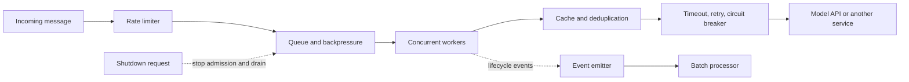
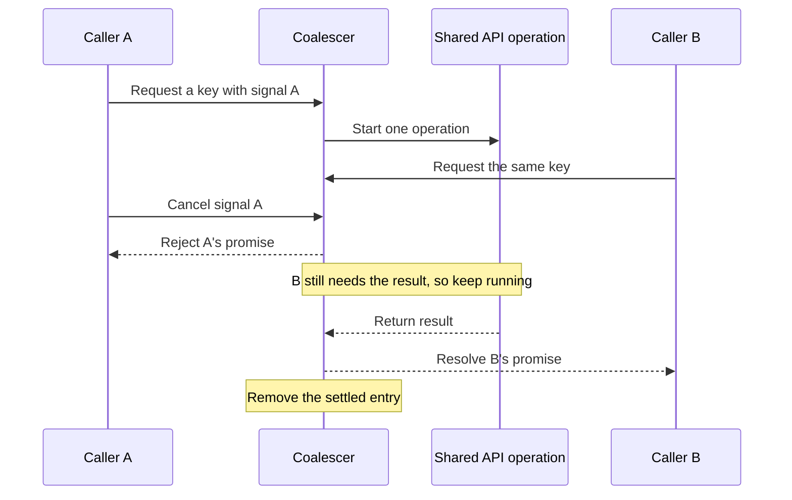
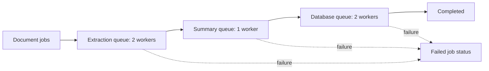

# AI Backend Lab

### Small JavaScript lessons. Reliable backend foundations.

**16 runnable lessons · Zero external dependencies · New concepts added weekly**

A hands-on learning series that breaks AI application backends into small, readable JavaScript examples. Each lesson focuses on one problem: coordinating work, avoiding duplicate requests, handling failures, or keeping a busy service responsive.

The examples simulate the backend around an LLM: the code that manages requests to a model or another service. Model training, inference engines, HTTP routes, databases, and authentication are outside the current lessons.

---

## Start here

Use **Node.js 22 or newer**. No API keys, accounts, or package installation are needed to run the examples.

```bash
git clone https://github.com/shahviraj222/ai-backend-lab.git
cd ai-backend-lab

# Run your first lesson.
node task-scheduler.js

# Explore a later concept.
node backpressure.js

# Run the regression tests.
npm test
```

Every lesson runs directly with `node <filename>.js`. Each file also exports its main functions; importing it does not run its demo.

```js
import { runTasks } from "./task-scheduler.js";

const results = await runTasks(
  [() => Promise.resolve("first"), () => Promise.resolve("second")],
  2,
);

console.log(results); // ["first", "second"]
```

## Learning path

The order below follows the original series. Filenames describe the concept; the numbers are a suggested reading order, not publication weeks.

| #   | Lesson                                                          | What you build                                                            | Where it helps                                                     |
| --- | --------------------------------------------------------------- | ------------------------------------------------------------------------- | ------------------------------------------------------------------ |
| 01  | [Task scheduler](task-scheduler.js)                             | A worker pool with a concurrency limit and ordered results                | Run a fixed set of API calls without starting all of them together |
| 02  | [Request deduplication](request-deduplication.js)               | A cache that shares in-flight promises and removes failed entries         | Avoid requesting the same data several times                       |
| 03  | [Event emitter](event-emitter.js)                               | `on`, `off`, `emit`, and `once` using a listener registry                 | Let different parts of an application react to events              |
| 04  | [Debounce](debounce.js)                                         | A function that runs after a burst of calls settles                       | Reduce repeated search or input-triggered work                     |
| 05  | [Retry](retry.js)                                               | A bounded retry loop with a delay between attempts                        | Recover from temporary service failures                            |
| 06  | [Rate limiter](rate-limiter.js)                                 | A per-user sliding window of accepted requests                            | Limit how frequently a user submits work                           |
| 07  | [LRU cache](lru-cache.js)                                       | A capacity-limited cache that refreshes recency on reads and updates      | Keep frequently used results in memory                             |
| 08  | [Timeout](timeout.js)                                           | A deadline built with `Promise.race` and timer cleanup                    | Stop waiting indefinitely for an operation                         |
| 09  | [Batch processor](batch-processor.js)                           | A buffer that flushes by size or elapsed time                             | Group analytics events or other small operations                   |
| 10  | [Circuit breaker](circuit-breaker.js)                           | Closed, open, and half-open states with one recovery probe                | Give a failing service time to recover                             |
| 11  | [Async queue](async-queue.js)                                   | A FIFO queue that wakes waiting consumers                                 | Receive messages as they arrive                                    |
| 12  | [Concurrent message processor](concurrent-message-processor.js) | A fixed pool of workers consuming a live queue                            | Process incoming messages with controlled concurrency              |
| 13  | [Graceful shutdown](graceful-shutdown.js)                       | A queue that closes and workers that drain accepted work                  | Finish accepted messages before stopping                           |
| 14  | [Backpressure](backpressure.js)                                 | Bounded buffering, waiting producers, and promise-based admission         | Slow producers when workers cannot keep up                         |
| 15  | [Request coalescing and cancellation](request-coalescing.js)    | One in-flight operation with independent caller promises and cancellation | Share identical requests while allowing each caller to leave       |
| 16  | [Document pipeline](document-pipeline.js)                       | Three asynchronous stages with independent worker limits and job status   | Extract text, summarize it, and save each document                 |

## Where these pieces fit

This is a conceptual flow showing where the lessons can be used together. The repository keeps them as individual exercises so each mechanism stays easy to inspect.



Three related controls solve different problems:

| Control           | Question it answers                                     | Example                                                    |
| ----------------- | ------------------------------------------------------- | ---------------------------------------------------------- |
| Rate limit        | How often may a user submit a request?                  | 3 requests per rolling 10 seconds                          |
| Concurrency limit | How much work may run at once?                          | 2 active message handlers                                  |
| Backpressure      | What happens when work arrives faster than it finishes? | Wait for queue space, then reject excess waiting producers |

## Behaviors to notice

### Coordinating work

- **Scheduler:** tasks start in input order and results stay in that order, even if tasks finish at different times. A failed task produces `{ success: false, message }`; other tasks continue.
- **Emitter:** listeners run synchronously in registration order. Each emission uses a snapshot. `once` is safe during nested emissions; `off` removes registrations matching the supplied callback. A thrown listener error propagates to the caller.
- **Debounce:** create the wrapper once and reuse it. Its closure retains access to the same `timer`, `delay`, and callback between calls; a separate call to `debounce()` creates separate state. Only the latest arguments and receiver are used. This example is for synchronous callbacks; calls to the wrapper do not return the eventual callback result.
- **Queue listeners:** `createMessageListener(queue)` consumes messages and broadcasts each one to a snapshot of registered callbacks. Callbacks are awaited in registration order; failures are logged so later listeners and messages still run. `onMessage()` returns an unsubscribe function. Register listeners before submitting messages. This basic listener runs continuously; shutdown is introduced in a later lesson.
- **Live workers:** FIFO describes the order messages are taken from the queue. Concurrent handlers may finish in a different order. Handler failures are logged, and the worker continues.

### Caching and failures

- **Request cache:** identical keys share the same promise. Successful results remain cached for the lifetime of the cache; failures are removed so the next call can retry. This lesson has no TTL or capacity limit.
- **Request coalescer:** only in-flight work is shared. Every caller receives its own promise, and completed requests are removed rather than cached. Cancelling one caller rejects only that caller, preserving the signal's abort reason. When the final caller cancels, the shared operation is aborted and its registry entry is removed. The API handler must honor the supplied `AbortSignal` to stop its underlying work. Choose a key that includes every input affecting the result, including user or tenant context when responses differ.
- **LRU cache:** reads and updates make an entry most recently used. Missing keys return `-1`. The array implementation keeps the mechanics visible and uses linear-time lookup and reordering.
- **Retry:** `maxAttempts` includes the first call. The last error is preserved. The example retries every failure with a fixed delay; deciding which operations and errors are safe to retry belongs to the caller.
- **Timeout:** the deadline rejects the wrapper and clears its timer. The underlying operation continues unless it separately supports cancellation.
- **Circuit breaker:** consecutive failures are counted in completion order. After the cooldown, only one recovery request is admitted. Late results from before an outage cannot change the recovered circuit.

### Buffering and lifecycle

- **Rate limiter:** accepted request timestamps define a rolling window. Expired timestamps and empty user entries are removed on subsequent calls. All state is local to one process, and cleanup scans the stored users.
- **Batcher:** the first item starts the wait timer. A full batch sends immediately; a partial batch sends when that timer expires. `flush()` sends the current buffer and can be awaited. It does not wait for previously dispatched batches. Automatic send failures reach `onError`; failed batches are not retried or requeued. Multiple sends may overlap.
- **Graceful shutdown:** new submissions fail immediately, queued and active messages finish, and `shutdown()` resolves after every worker exits. Failed messages are logged, so completion means every accepted message was attempted. A handler that never settles will keep shutdown waiting.
- **Backpressure:** `await push(message)` means **accepted**, not processed. The default pending-producer limit equals the queue capacity. Closing rejects producers still waiting for admission and drains accepted messages. `shutdown()` waits for processing to finish.
- **Document pipeline:** extraction, summarization, and saving have separate queues, with default worker limits of 2, 1, and 2. Each document advances only after its current stage succeeds. `push()` returns `{ id, done }`; `done` resolves to a status snapshot for either success or failure, so inspect `status` and `error`. `getStatus(id)` returns a fresh snapshot or `null`. A failed document stops at the failing stage while other jobs continue. This lesson retains job history in memory and uses unbounded stage queues; it does not yet combine pipeline processing with backpressure, cancellation, or graceful shutdown.

```js
import { createMessageProcessor } from "./backpressure.js";

const processor = createMessageProcessor(
  2, // Active workers.
  3, // Buffered messages.
  async (message) => console.log("Processed:", message),
);

for (const message of ["A", "B", "C", "D", "E", "F"]) {
  await processor.push(message);
}

await processor.shutdown();
```

Await admission in the producer loop to let the queue slow it down. Starting thousands of producer promises at once still creates work outside the queue. These limits count messages, not bytes, and the examples use in-memory state without persistence across process restarts.

## Share work without sharing cancellation

Two callers can share an API operation while keeping control of their own waiting time:



If every caller cancels, the coalescer aborts the shared operation. A later request for the same key starts fresh, and cleanup from the old operation cannot remove the new entry. Run `node request-coalescing.js` to see both cancellation scenarios.

## Move documents through independent stages

The pipeline accepts three handlers, so the example can simulate extraction, an AI API, and storage without making network calls. Its runnable demo includes a deliberately failing document.



```js
import { createDocumentPipeline } from "./document-pipeline.js";

const records = new Map();
const pipeline = createDocumentPipeline({
  extractText: async (location) => `Text from ${location}`,
  summarizeText: async (text) => `Summary of ${text}`,
  saveDocument: async (record) => records.set(record.id, record),
});

const job = pipeline.push("document.pdf");
console.log(await job.done);
```

Each `done` promise reports one document's outcome. To change a stage's worker count, pass a `concurrency` object with `extraction`, `summarization`, or `database`; omitted values keep their defaults.

## Weekly learning log

The first collection introduced 14 lessons. The series now contains 16, with new source changes reviewed weekly.

| Published         | Update                                                                                                                                     |
| ----------------- | ------------------------------------------------------------------------------------------------------------------------------------------ |
| November 13, 2026 | Published the first 14 cleaned and tested backend lessons.                                                                                 |
| November 17, 2026 | Added request coalescing with per-caller cancellation and a document-processing pipeline; expanded the async queue with message listeners. |

| Collection                         | Status    | Focus                                                                       |
| ---------------------------------- | --------- | --------------------------------------------------------------------------- |
| Foundations                        | Available | Scheduling, caching, events, debounce, retry, rate limiting                 |
| Reliability                        | Available | LRU eviction, deadlines, batching, circuit breaking                         |
| Message processing                 | Available | Live queues, worker pools, graceful shutdown, backpressure                  |
| Request coordination and pipelines | Available | Per-caller cancellation, shared requests, and independent processing stages |
| Future explorations                | Planned   | Retry backoff, streaming responses, durable queues                          |

Lessons originate in [ReactRevision / Javascript / Questions](https://github.com/shahviraj222/ReactRevision/tree/main/Javascript/Questions). This repository publishes reviewed adaptations with consistent filenames and runnable demos. [The sync record](.sync-state.json) maps source file versions to published lessons, helping later updates preserve existing fixes and avoid duplicate imports. Useful study-note explanations are condensed into this guide.

For each weekly addition:

1. Choose one backend problem and a descriptive `kebab-case.js` filename.
2. Keep the implementation focused, export the main function, and include a small runnable demo.
3. Put the explanation and meaningful limitations in this README; keep code comments brief.
4. Add a regression test for the behavior or edge case, then run `npm test`.
5. Add the lesson to the learning path and commit a small, related group of files.

## Verification

The tests cover all 16 lessons using Node's built-in test runner:

- [Core concepts](test/concepts.test.js): concurrency limits, caching, retry, eviction, timeouts, batching, circuit recovery, queues, shutdown, and backpressure.
- [Queue listeners](test/async-queue-listeners.test.js): broadcasting, unsubscribe behavior, listener snapshots, and failure isolation.
- [Request coalescing](test/request-coalescing.test.js): per-caller cancellation, shared aborts, listener cleanup, fresh retries, and late-response races.
- [Document pipeline](test/document-pipeline.test.js): data flow, stage limits, overlapping stages, job status, and isolated failures.

```bash
npm test
```

The examples intentionally remain small and self-contained. Queue logic is repeated across the later lessons so the change from a basic queue to shutdown and backpressure is visible in each file.

---

**Learn one mechanism. Run it. Change it. Observe what happens.**
